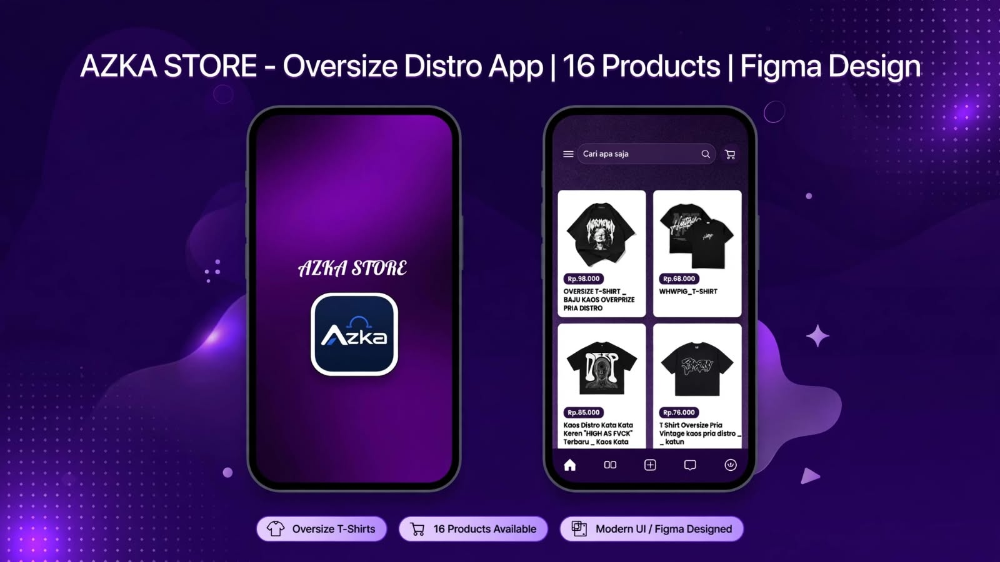

  

<h3 align="center">Information Systems Student | Full Stack Developer</h3>

  Passionate about building modern web applications with clean design and good user experience.

  
  

---

### 🛠️ Tech Stack

  
  
  
  
  
  

---

### 🎨 Figma Design - AZ Store

  

> **AZ Store** - Aplikasi E-Commerce Oversize T-Shirt Distro
> 12 Product Screens | 3 Checkout Flows | Purple Modern UI
> Designed in Figma - Click badge to view prototype

🔗 **Link:** https://www.figma.com/design/WF7QjzBzrWMthT6nz6Zpa9/Projek-Figma-Azka?node-id=1-3&t=4E9JU4XzvDJiSamN-1

---

### 🚀 About Me
- 🎓 Information Systems Student at Jambi
- 💻 Full Stack Developer
- 🌱 Currently learning JavaScript & System Design
- 📍 Jambi, Indonesia

---

### 🛠️ Skills

  
   
  

---

### 📊 GitHub Stats

  
   
  

---

 
  📫 How to reach me : github.com/amzahaja67-nox

